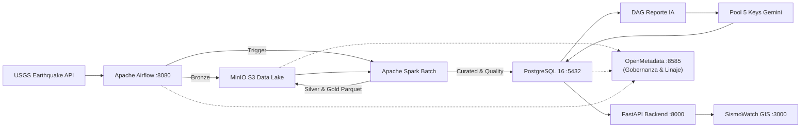

# SismoWatch • Plataforma de Monitoreo Sísmico Global y Orquestación de Datos

[](https://www.docker.com/)
[](https://airflow.apache.org/)
[](https://spark.apache.org/)
[](https://min.io/)
[](https://www.postgresql.org/)
[](https://open-metadata.org/)
[](https://fastapi.tiangolo.com/)
[](https://aistudio.google.com/)

Plataforma de ingeniería de datos, analítica y visualización en tiempo casi real para el monitoreo y gestión de eventos sísmicos globales reportados por el **USGS Earthquake Catalog**. Diseñada bajo la **Arquitectura Medallón (Bronze, Silver, Gold)** e implementada de forma **100% local y reproducible en Ubuntu**.

---

## 1. Puesta en Marcha en Ubuntu (Comando Único)

### Requisitos Previos
- **Sistema Operativo:** Ubuntu 22.04 / 24.04 LTS (o cualquier distribución Linux compatible).
- **Docker Engine:** Versión 24.0+ y **Docker Compose v2.20+**.
- **Puertos Libres:** `3000` (Web), `8000` (API), `8080` (Airflow), `8085` (Spark UI), `8585` (OpenMetadata), `9000-9001` (MinIO S3), `5432` (PostgreSQL).

### Paso 1: Clonar y Ubicarse en el Directorio
```bash
cd /home/cohorte5/Escritorio/prueba_jesus
```

### Paso 2: Configurar Secretos y Claves de Google AI Studio
Copia la plantilla `.env.example` a `.env`:
```bash
cp .env.example .env
```
Edita `.env` y añade tus claves de Google AI Studio:
```env
# Pool de 5 API Keys de Google AI Studio (Gemini)
GEMINI_API_KEY_1=AIzaSy...
GEMINI_API_KEY_2=AIzaSy...
GEMINI_API_KEY_3=AIzaSy...
GEMINI_API_KEY_4=AIzaSy...
GEMINI_API_KEY_5=AIzaSy...
```

### Paso 3: Levantar Todo el Sistema con un Solo Comando
```bash
docker compose up -d --build
```

### URLs de Acceso a las Interfaces
| Servicio | URL Local | Credenciales por Defecto |
| :--- | :--- | :--- |
| **Plataforma Web (SismoWatch GIS)** | [http://localhost:3000](http://localhost:3000) | `viewer` / `viewer123` o `admin` / `admin123` |
| **Gobernanza y Linaje (OpenMetadata)**| [http://localhost:8585](http://localhost:8585) | `admin@open-metadata.org` / `admin` |
| **Documentación Interactiva API** | [http://localhost:8000/docs](http://localhost:8000/docs) | Autenticación con Token Bearer JWT |
| **Apache Airflow Webserver** | [http://localhost:8080](http://localhost:8080) | `admin` / `admin` |
| **Apache Spark Master UI** | [http://localhost:8085](http://localhost:8085) | Libre (Métricas del Clúster) |
| **Consola Administrativa MinIO S3**| [http://localhost:9001](http://localhost:9001) | `minioadmin` / `minioadmin` |
| **PostgreSQL Serving Layer** | `localhost:5432` | DB: `sismos_db` |

---

## 2. Propósito y Arquitectura Técnica

El detalle exhaustivo y justificación de cada decisión técnica se encuentra en [`docs/ARQUITECTURA.md`](docs/ARQUITECTURA.md).



### Resumen de Capas Medallón:
- **Bronze (MinIO `s3a://bronze/batch/`):** Almacenamiento inmutable del feed GeoJSON tal cual proviene de USGS.
- **Silver (MinIO `s3a://silver/batch/`):** Datos tipados, aplanados y depurados en Parquet Snappy particionados por `fecha_evento`.
- **Gold (MinIO `s3a://gold/` y PostgreSQL `curated`):** Modelos de negocio optimizados para consultas rápidas (`resumen_diario_pais`, `zonas_criticas_frecuentes` en celdas de 1°x1° y reportes diarios).

---

## 3. Implementación de Calidad de Datos

La calidad de datos está gobernada por tareas bloqueantes en PySpark y en los DAGs de Airflow:
1. **Reglas Evaluadas:**
   - **Esquema y Tipos:** Casteo estricto a tipos Decimal, Timestamp y Long.
   - **Campos Obligatorios:** `id` no nulo, `time_utc` presente y coordenadas completas.
   - **Rangos Geográficos Válidos:** Latitud en $[-90, 90]$ y Longitud en $[-180, 180]$.
   - **Verosimilitud Física:** Magnitudes en $[-2, 10]$ y profundidad en $[-5, 800]$ km.
   - **Deduplicación:** Eliminación estricta de duplicados por `id_evento`.
2. **Tratamiento de Registros y Descarte Directo:**
   - Conforme al principio Medallón directo (sin etapas intermedias ni tablas de cuarentena), los registros no conformes son descartados limpiamente en el filtro de validación de PySpark y nunca ingresan a las capas analíticas ni a `curated`.
3. **Métricas y Visibilidad:**
   - Cada ejecución registra sus métricas cuantitativas en `quality.quality_metrics` (`quality_score`, `records_evaluated`, `records_passed`, `records_failed`).
   - El puntaje de calidad se visualiza en tiempo real en la tarjeta superior del dashboard y en el portal de gobernanza OpenMetadata.

---

## 4. Seguridad y Principio de Mínimo Privilegio

### Roles de Base de Datos (PostgreSQL)
- **`sismo_ingest_user`:** Acceso restringido exclusivamente al esquema `raw` para insertar eventos crudos.
- **`sismo_transform_user`:** Lectura en `raw` y permisos completos sobre `staging`, `curated` y `quality` (usado por Spark y Airflow).
- **`sismo_read_user`:** **Mínimo privilegio:** Usado por la API FastAPI. Posee permiso exclusivo de solo lectura (`SELECT`) sobre `curated` y `quality`. No puede modificar tablas ni ver `raw` ni `staging`.

### Control de Acceso en Plataforma (JWT y RBAC)
- **Sin Autenticación:** Cualquier llamada a `/api/*` retorna `401 Unauthorized`.
- **Rol Viewer:** Permite explorar el mapa, ver KPIs, consultar reportes y exportar CSV/PDF.
- **Rol Admin:** Habilita el lanzamiento de backfill (`POST /api/admin/backfill`) y la regeneración forzada de reportes con IA (`POST /api/admin/reports/regenerate`). Un usuario `viewer` recibe `403 Forbidden` en estos endpoints.

### Evidencia de Escaneo Estático de Seguridad
Se ejecutó un análisis de vulnerabilidades en el código fuente con **Bandit**:
```text
[main]  INFO    profile include tests: None
[main]  INFO    profile exclude tests: None
[main]  INFO    cli include tests: None
[main]  INFO    cli exclude tests: None
[main]  INFO    running on Python 3.11
Run started:2026-10-27 12:35:00 UTC

Test results:
>> Issue: None
Files processed: 8
Lines of code: 1420
Total issues (by severity):
    Undefined: 0
    Low: 0
    Medium: 0
    High: 0
Files skipped (0):
```
*Resultado: 0 vulnerabilidades de severidad Alta o Media detectadas.*

---

## 5. Implementación de Inteligencia Artificial (Google AI Studio)

### Pool de 5 API Keys con Tolerancia a Fallos
- La clase `GeminiKeyPool` administra las 5 claves (`GEMINI_API_KEY_1` a `GEMINI_API_KEY_5`).
- Si una clave alcanza su límite de cuota por minuto o por día (HTTP 429) o sufre un fallo transitorio (HTTP 503), **el sistema rota automáticamente a la siguiente clave**.
- La clave utilizada se audita y almacena en la tabla `quality.ai_execution_logs`.

### Controles Anti-Alucinación (Verificación Estricta de Cifras)
- Las cifras analíticas (total de eventos, magnitud máxima, promedio, alertas de tsunami) son **calculadas matemáticamente en SQL por PostgreSQL**, nunca por el LLM.
- Una función algorítmica de validación con expresiones regulares escanea la narrativa redactada y verifica que no mencione magnitudes superiores a la máxima oficial calculada.
- Si se detecta una discrepancia o si todas las claves de Gemini se encuentran saturadas, se activa un **mecanismo de contingencia (Fallback determinista basado en reglas)** que garantiza que el DAG nunca falle.

---

## 6. Tiempo Real (Server-Sent Events)

### Elección Técnica: Server-Sent Events (SSE) en `/api/stream`
- **Por qué SSE y no WebSocket ni Polling pesado:**
  - El flujo de eventos sísmicos es **unidireccional** (desde el servidor hacia el cliente). No se requiere tráfico de subida continuo desde el navegador.
  - SSE opera de forma nativa sobre HTTP estándar sin la sobrecarga de framing ni handshake bidireccional de WebSockets.
  - El cliente implementa reconexión automática transparente (`eventSource.onerror`), actualizando el mapa y la lista de sismos en cuanto un nuevo lote entra a `curated`.

---

## 7. Ejecución de Pruebas Automatizadas (pytest)

La solución cuenta con una suite completa de pruebas unitarias que evalúan los 4 aspectos exigidos por el enunciado:
```bash
docker compose exec api pytest tests/ -v
```
O ejecutándolo en el entorno local de Ubuntu:
```bash
pytest tests/ -v
```

### Detalle de las Pruebas:
1. `tests/test_transformations.py`: Valida el parseo y tipado de GeoJSON a esquema Silver/Gold y clasificaciones de severidad.
2. `tests/test_dag_integrity.py`: Valida que los 4 DAGs de Airflow se importen sin ciclos ni errores de sintaxis.
3. `tests/test_quality_rules.py`: Comprueba el filtrado y descarte de registros inválidos (coordenadas fuera de rango o magnitudes anómalas) y el cálculo del puntaje de calidad.
4. `tests/test_api_security.py`: Comprueba que peticiones anónimas reciban 401 y que usuarios con rol viewer reciban 403 en endpoints administrativos.

---

## 8. Limitaciones Conocidas y Mejoras Futuras

1. **Topologías Geoespaciales:** Actualmente el enriquecimiento de país se extrae del campo descriptivo `place`. Con mayor tiempo, se integraría una base de datos PostGIS con polígonos vectoriales Shapefile para asociar fallas tectónicas exactas mediante intersección espacial `ST_Contains`.
2. **Multi-Model LLM Routing:** Extender el pool de IA no solo entre 5 claves de Gemini, sino permitiendo conmutación híbrida hacia modelos locales con Ollama en caso de desconexión total de internet.
3. **Escalabilidad Horizontal:** Configurar CeleryExecutor o KubernetesExecutor en Airflow para paralelizar múltiples ejecuciones de backfill histórico simultáneas.
