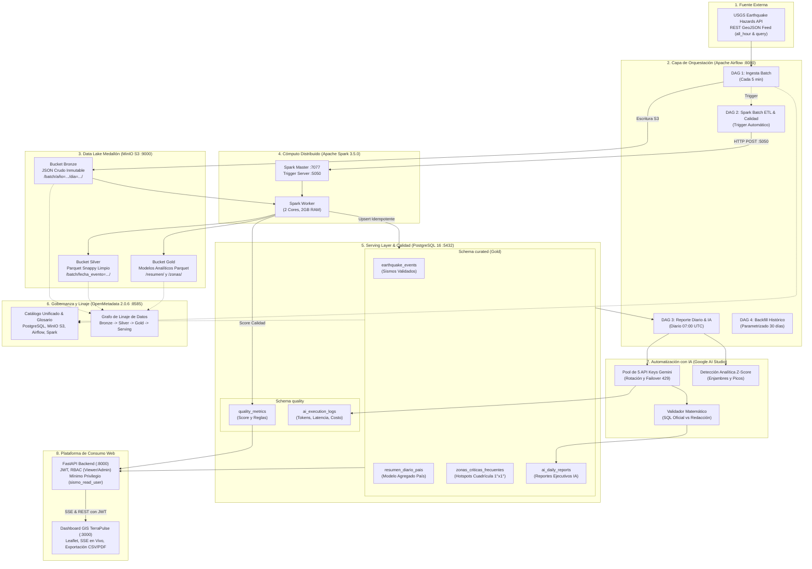

# Arquitectura de Datos y Documento de Diseño Técnico: SismoWatch

## 1. Propósito de la Arquitectura

### Problema que Resuelve
SuperApp lanza **SismoWatch**, su nueva vertical de monitoreo sísmico global en tiempo casi real. Los eventos geofísicos mundiales son emitidos continuamente por el Servicio Geológico de los Estados Unidos (USGS Earthquake Hazards Program) a través de un feed público que se actualiza minuto a minuto. Sin embargo, dicha fuente pública presenta limitaciones operativas severas:
- **No persiste historial:** El feed de tiempo real solo muestra la última hora o las últimas 24 horas y se sobrescribe sin retención histórica.
- **Sin validación de calidad:** Contiene datos con revisiones pendientes, coordenadas erróneas o lecturas de sensores anómalas.
- **Sin agregación analítica ni detección de anomalías:** La información cruda no resume la energía liberada ni detecta enjambres sísmicos.
- **Sin plataforma de consumo segura:** No cuenta con control de acceso por roles, alertas tempranas ni interfaces analíticas para la toma de decisiones.

### A Quién Beneficia
- **Equipos de Operaciones y Rescate:** Visualización inmediata en mapas GIS tácticos con alertas sonoras y visuales cuando ocurren sismos mayores ($Mw \ge 6.0$) o con potencial de tsunami.
- **Analistas de Gestión de Riesgo y Protección Civil:** Acceso a modelos agregados diarios por país/región, cuadrículas de 1°x1° para identificación de fallas activas y reportes ejecutivos redactados con Inteligencia Artificial.
- **Auditoría y Data Governance:** Catálogo centralizado y linaje de datos de extremo a extremo en OpenMetadata 2.0.6, junto con seguimiento cuantitativo del puntaje de calidad de datos en `quality.quality_metrics`.

### Decisiones que Habilita
- Evacuación preventiva y despliegue de recursos de emergencia ante sismos críticos.
- Comparación de patrones sísmicos históricos con la sismicidad actual.
- Monitoreo de la estabilidad del pipeline de ingesta y cumplimiento de SLAs de frescura.

---

## 2. Diagrama de Componentes y Capas

---

## 3. Justificación de Herramientas Elegidas

| Herramienta | Rol en la Solución | Justificación Técnica |
| :--- | :--- | :--- |
| **Apache Airflow** | Orquestación Batch | Gestión nativa de dependencias mediante grafos dirigidos acíclicos (DAGs), reintentos con espera exponencial, ejecución parametrizada (Backfill) y callbacks de fallo (`on_failure_callback`). |
| **MinIO S3** | Data Lake Medallón | Almacenamiento inmutable compatible con la API de Amazon S3. Permite particionamiento temporal estilo Hive (`año=.../mes=.../dia=...`) habilitando *Partition Pruning* sin costo de infraestructura cloud. |
| **Apache Spark** | Cómputo Masivo | Motor distribuido en memoria que procesa lotes masivos con el optimizador Catalyst. Escribe en formato columnar Parquet con compresión Snappy, reduciendo el I/O en disco hasta en un 75%. |
| **PostgreSQL 16** | Serving Layer Relacional | Base de datos ACID de alto rendimiento para lecturas de la API. Soporta schemas separados (`curated`, `quality`) y control de acceso granular con roles de mínimo privilegio. |
| **OpenMetadata 2.0.6** | Catálogo y Gobernanza | Plataforma unificada de gobernanza de datos local. Automatiza el catálogo de servicios (PostgreSQL, MinIO S3, Airflow DAGs, Spark pipelines), publica el glosario de términos geofísicos y traza el grafo de linaje de datos de extremo a extremo sin dependencia de Kafka. |
| **Google AI Studio (Gemini)** | IA Generativa y Reportes | Modelo multimodal y lingüístico de baja latencia (`gemini-1.5-flash`). La arquitectura implementa un **Pool de 5 API Keys** con rotación automática y fallback determinista ante agotamiento de cuotas. |
| **FastAPI** | Backend de Consumo | Framework asíncrono en Python de alto rendimiento con validación automática mediante Pydantic, documentación interactiva OpenAPI/Swagger y soporte nativo de Server-Sent Events (SSE). |
| **Nginx + Leaflet.js** | Frontend Cartográfico | Dashboard táctico sin dependencias de API keys cartográficas externas (OpenStreetMap, ESRI Dark Canvas) con persistencia de sesión JWT en `localStorage` e integración directa con OpenMetadata. |

---

## 4. Separación en Capas Medallón

1. **Capa Bronze (`raw` en MinIO S3 y PostgreSQL):**
   - **Formato:** JSON crudo inmutable (`features` completas de GeoJSON).
   - **Regla:** Ningún dato se modifica, limpia ni descarta. Preserva el estado original de la telemetría externa para auditoría y reprocesamiento.
2. **Capa Silver (`staging` en MinIO S3 Parquet):**
   - **Formato:** Tabular aplanado, tipado estrictamente (`DecimalType(4,2)` para magnitudes, `TimestampType` para UTC).
   - **Regla:** Se filtran registros anómalos o incompletos. Se añade el enriquecimiento inicial (`alert_level`, `depth_type`, `country_region`).
3. **Capa Gold (`curated` en MinIO y PostgreSQL Serving Layer):**
   - **Formato:** Tablas físicas consolidadas e indexadas listas para consumo:
     - `curated.earthquake_events`: Detalle de sismos validados con upsert idempotente por `id`.
     - `curated.resumen_diario_pais`: Agregaciones analíticas por país/región y día.
     - `curated.zonas_criticas_frecuentes`: Hotspots en cuadrículas geográficas de 1 grado x 1 grado.
     - `curated.ai_daily_reports`: Informes narrativos ejecutivos validados contra las métricas oficiales.
4. **Capa Quality (`quality` en PostgreSQL):**
   - `quality.quality_metrics`: Métricas de cada corrida batch (score de calidad, total evaluados, registros válidos y descartados).
   - `quality.ai_execution_logs`: Trazabilidad de uso de API Keys de Gemini, tokens, latencia, modelo y estado de éxito/failover.
   *(Nota: Se eliminó la tabla de cuarentena y landing conforme a requerimientos de diseño limpio Medallón directo).*

---

## 5. Modelo de Datos Documentado

### Tabla: `curated.earthquake_events`
- `id` (VARCHAR(50), PK): Identificador único emitido por USGS (ej. `us7000m123`).
- `mag` (NUMERIC(4,2)): Magnitud en escala de momento.
- `mag_type` (VARCHAR(15)): Método de cálculo (ej. `mww`, `ml`).
- `place` (VARCHAR(255)): Descripción geográfica original.
- `country_region` (VARCHAR(100)): País o estado normalizado.
- `time_utc` (TIMESTAMP): Fecha y hora exacta del evento en UTC.
- `longitude` (NUMERIC(7,4)), `latitude` (NUMERIC(7,4)): Coordenadas WGS84.
- `depth_km` (NUMERIC(6,2)): Profundidad hipocentral en kilómetros.
- `tsunami` (INT): 1 si hay alerta de tsunami, 0 en caso contrario.
- `sig` (INT): Significancia del sismo calculada por USGS (0 a 1000).
- `alert_level` (VARCHAR(20)): `CRITICO` ($Mw \ge 6.0$), `MODERADO` ($5.0 \le Mw < 6.0$), `LEVE` ($Mw < 5.0$).
- `depth_type` (VARCHAR(20)): `SUPERFICIAL` ($\le 70$ km), `INTERMEDIA` ($70-300$ km), `PROFUNDA` ($> 300$ km).

### Tabla: `curated.resumen_diario_pais`
- `fecha_evento` (DATE, PK): Día del evento.
- `pais_estado` (VARCHAR(100), PK): Región geográfica.
- `total_sismos` (INT), `magnitud_maxima` (NUMERIC(4,2)), `magnitud_promedio` (NUMERIC(4,2)), `profundidad_promedio_km` (NUMERIC(8,2)), `total_alertas_tsunami` (INT), `sismos_criticos_m6` (INT), `sismos_peligrosos_m5` (INT).

### Tabla: `curated.zonas_criticas_frecuentes`
- `cuadricula_lat` (NUMERIC(5,1), PK), `cuadricula_lon` (NUMERIC(5,1), PK): Coordenadas de la celda de 1°x1°.
- `total_sismos_registrados` (INT), `sismos_graves_m5` (INT), `magnitud_maxima` (NUMERIC(4,2)), `nivel_alerta` (VARCHAR(20)).

### Tabla: `quality.quality_metrics`
- `id` (SERIAL, PK): Identificador secuencial de la auditoría.
- `evaluated_at` (TIMESTAMP): Momento de la auditoría.
- `batch_id` (VARCHAR(100)): Identificador del lote procesado.
- `records_evaluated` (INT): Total de registros procesados.
- `records_passed` (INT): Registros conformes que pasaron a Silver/Gold.
- `records_failed` (INT): Registros no conformes descartados.
- `quality_score` (NUMERIC(5,2)): Porcentaje de calidad ($0.00$ a $100.00$).

### Tabla: `quality.ai_execution_logs`
- `id` (SERIAL, PK): Identificador de la ejecución del modelo.
- `report_date` (DATE): Fecha del informe analítico.
- `api_key_used` (VARCHAR(50)): Clave rotada del pool utilizada.
- `model_name` (VARCHAR(50)): Nombre del modelo (ej. `gemini-1.5-flash`).
- `latency_ms` (INT): Latencia de la inferencia en milisegundos.
- `status` (VARCHAR(20)): `SUCCESS`, `FAILOVER` o `FALLBACK`.

---

## 6. Seguridad y Principio de Mínimo Privilegio

La base de datos cuenta con 3 roles estrictamente delimitados:
1. **`sismo_ingest_user`:** Solo posee permisos de `INSERT`, `SELECT` y `UPDATE` sobre el esquema `raw`.
2. **`sismo_transform_user`:** Usado por Spark Batch y Airflow; posee lectura en `raw` y privilegios completos sobre `staging`, `curated` y `quality`.
3. **`sismo_read_user`:** Usado por la API FastAPI; **únicamente tiene permisos `SELECT` sobre `curated` y `quality`**. No puede modificar datos ni acceder a `raw` ni a `staging`.

En la capa de aplicación, el control de acceso se gestiona mediante tokens **JWT**:
- **Visitante (sin token):** Cualquier petición a `/api/*` retorna `401 Unauthorized`.
- **Viewer:** Puede ver el dashboard, mapas, series temporales, métricas de calidad y exportar reportes. Si intenta disparar backfills o regeneración de reportes de IA, recibe un estricto `403 Forbidden`.
- **Admin:** Posee acceso total a las métricas del pipeline y a los endpoints administrativos de backfill (`POST /api/admin/backfill`) y regeneración de IA (`POST /api/admin/reports/regenerate`).

---

## 7. Decisiones Técnicas y Trade-offs

### ¿Por qué Apache Airflow y no un Cron tradicional?
- Un cron de Linux carece de trazabilidad gráfica, reintentos exponenciales automáticos, gestión de dependencias entre tareas, backfills históricos parametrizados y alertas integradas (`on_failure_callback`). Airflow centraliza la observabilidad y desacopla la lógica de planificación del cómputo.

### ¿Por qué separar en capas Bronze, Silver y Gold?
- Si se procesara directo de la API a la tabla final, un cambio de esquema o una falla en una fórmula obligaría a perder el histórico o reprocesar desde cero llamando a USGS. Con la capa Bronze inmutable, los datos originales siempre están a salvo. Silver asegura la limpieza tipada y Gold optimiza los tiempos de respuesta del dashboard al entregar datos ya agregados.

### ¿Qué se haría diferente en un entorno de producción a gran escala?
1. **Almacenamiento Cloud:** Migrar MinIO local a Amazon S3 o Google Cloud Storage con políticas de ciclo de vida (Life Cycle Policies) para mover lotes antiguos a Glacier.
2. **Cómputo Elastic:** Reemplazar el clúster local de Spark por AWS EMR Serverless o Databricks para escalar horizontalmente según la demanda de cómputo.
3. **Serving Layer Distribuida:** Utilizar Amazon Aurora PostgreSQL con réplicas de solo lectura para soportar miles de usuarios concurrentes en la plataforma web.
4. **Secrets Manager:** Reemplazar variables de entorno en `.env` por HashiCorp Vault o AWS Secrets Manager con rotación automática de claves.
